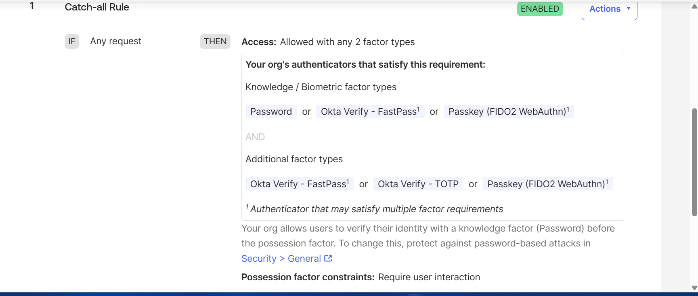
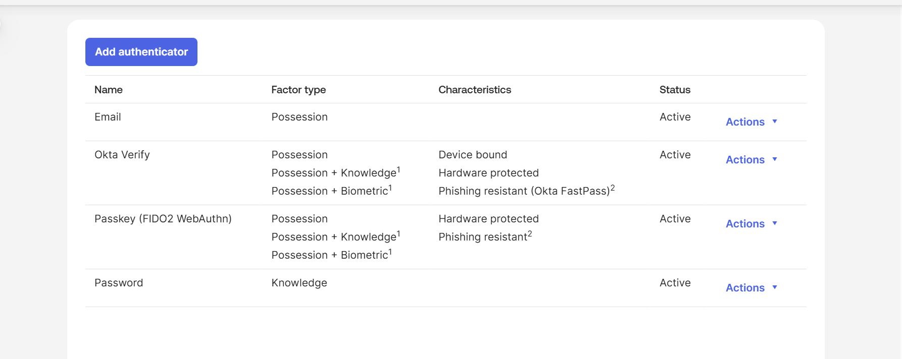
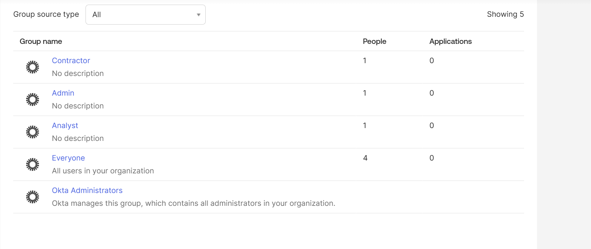
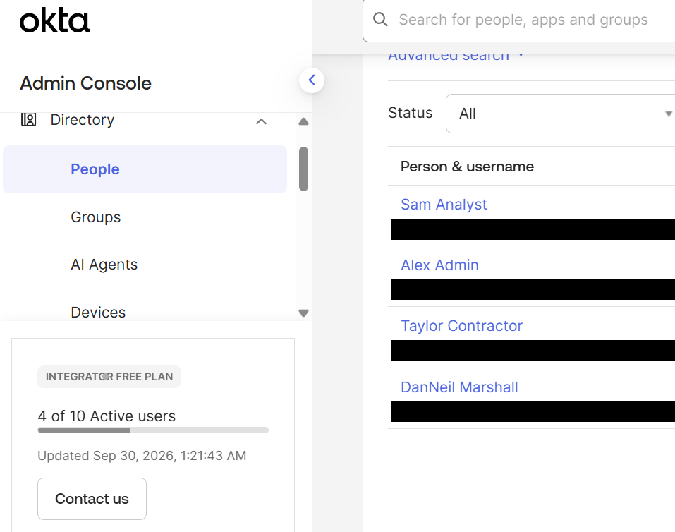
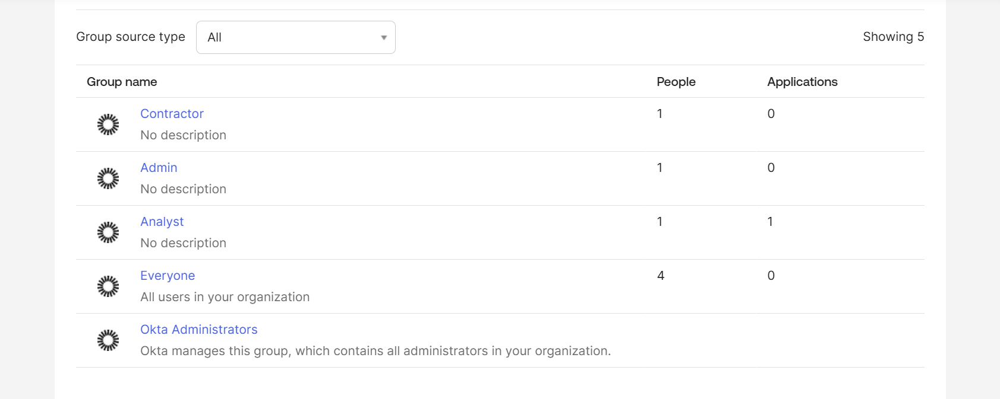
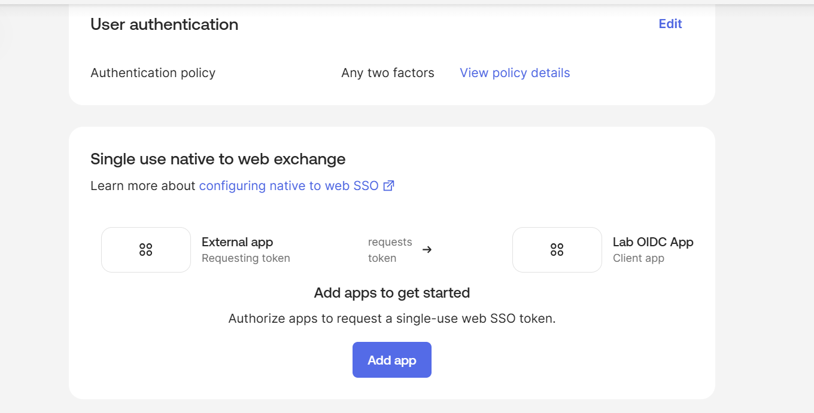
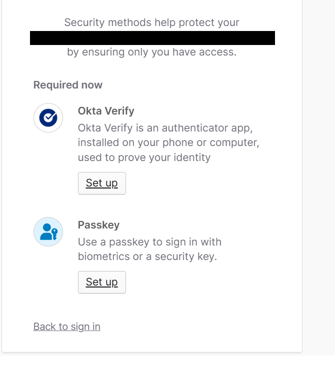

# Okta Identity Lab: SSO, SAML/OIDC, SCIM and MFA

## Goal
Get hands-on with workforce identity: build a small Okta org, enforce MFA, connect a test app with SSO, and use the Okta API with Python to audit users who lack MFA.

## Environment
- Okta Integrator Free Plan org (org name redacted in screenshots)
- One super-admin account (mine); three test users
- Python 3.13 with `requests` (for the audit script)

## Concepts covered
| Concept | What it is | Where it shows up in this lab |
|---|---|---|
| SSO | One login to reach many apps | "Lab OIDC App" is reached through Okta sign-in |
| SAML | XML assertions from IdP to SP | Studied only; the app I built uses OIDC |
| OIDC | JSON/JWT sign-in built on OAuth 2.0 | "Lab OIDC App" (OIDC web application, authorization code flow) |
| SCIM | Automatic user provisioning/deprovisioning | Studied, not built (see the SCIM note below) |
| MFA | Second factor; FIDO2/passkeys are phishing-resistant | "Any two factors" policy; Okta Verify and Passkey (FIDO2 WebAuthn) authenticators active |

## Steps performed
1. **Org setup.** Created an Okta Integrator Free Plan org and signed in as the super admin with Okta Verify MFA (my phone enrolled as the admin's authenticator).
2. **Users.** Created three test users: `alex.admin`, `sam.analyst` and `taylor.contractor`, with plus-addressed emails so notifications reach one inbox. Admin-set passwords, so each user must change it at first sign-in.
3. **Groups.** Created `Admin`, `Analyst` and `Contractor`, one test user in each (Alex, Sam, Taylor).
4. **Authenticators and enrollment.** Confirmed Email, Okta Verify (FastPass, phishing resistant) and Password were active. Added **Passkey (FIDO2 WebAuthn)**, which only became active after the final **Add** click at the bottom of its setup page, then set Passkey to *Optional* in the default enrollment policy. Password stays *Required*.
5. **MFA policy.** The default app sign-in policy "Any two factors" (Catch-all Rule) already requires two factor types for every sign-in. I verified its rule and confirmed the new app inherits it.
6. **SSO app.** Created "Lab OIDC App" (OIDC, Web Application) and assigned it only to the `Analyst` group. Verified on the Groups page that only Analyst has an application assigned.
7. **Least privilege test (fixed test design).** My first check was flawed: the app used "App Only" login, so no user would ever see a dashboard tile and an empty dashboard would prove nothing. I fixed the design and used these criteria for a valid denial test:
   - **Positive control first:** the app is made visible ("Either Okta or App" login, "Display application icon to users") and an authorized user must be able to see it. `sam.analyst` (Analyst group) signed in, changed the initial password, satisfied the second-factor requirement with a passkey, and the **Lab OIDC App** tile appeared.
   - **Negative case under the same conditions:** same app settings, same fresh Incognito browser, same sign-in flow. `taylor.contractor` (Contractor group) signed in, and Account settings confirmed the same strength of sign-in: password, an enrolled passkey (Windows Hello) and Okta Verify. The dashboard showed no apps.
   - **Intended difference:** group membership (Analyst vs Contractor), which is what the assignment controls.
   - **Evidence:** the assignment screenshot (Analyst has 1 application, others 0) and the sign-on policy screenshot above.
8. **Audit script.** `scripts/users_without_mfa.py` calls the Okta API (`/api/v1/users` and `/api/v1/users/{id}/factors`) to list users with no enrolled factor. Ran it against the lab org; it flagged the 3 test users (see output below).

## SCIM note (studied, not built)
SCIM (System for Cross-domain Identity Management) is a REST/JSON standard that lets an identity provider create, update and deactivate user accounts in downstream apps automatically. It maps to the joiner, mover and leaver lifecycle: adding a user to a group provisions their account, a profile or group change updates it, and deactivating the user removes access so no orphaned accounts are left behind. I did not build SCIM provisioning because the free Integrator plan gave me no real target app to provision into.

## Audit script
Uses an API token read from an environment variable. **Never commit a token.**

```python
import os, requests

ORG = os.environ["OKTA_ORG_URL"]      # e.g. https://<your-org>.okta.com
TOKEN = os.environ["OKTA_API_TOKEN"]
H = {"Authorization": f"SSWS {TOKEN}", "Accept": "application/json"}

def get(url):
    while url:
        r = requests.get(url, headers=H, timeout=30)
        r.raise_for_status()
        yield from r.json()
        url = r.links.get("next", {}).get("url")

for user in get(f"{ORG}/api/v1/users?limit=200"):
    factors = requests.get(f"{ORG}/api/v1/users/{user['id']}/factors", headers=H, timeout=30).json()
    if not factors:
        print(user["profile"]["login"], "- NO MFA ENROLLED")
```

Output from my run (domain redacted):

```
Checked 4 active/pending users
3 user(s) with NO MFA enrolled:
  - sam.analyst@<redacted>  (status: PASSWORD_EXPIRED)
  - alex.admin@<redacted>  (status: PASSWORD_EXPIRED)
  - taylor.contractor@<redacted>  (status: PASSWORD_EXPIRED)
```

The admin account is not listed because it has Okta Verify enrolled. The three test users show `PASSWORD_EXPIRED` because they have not yet completed first sign-in, which is where they would enroll a factor. The script therefore flags exactly the users an admin would need to chase for MFA enrollment.

### Running and cleaning up
```powershell
$env:OKTA_ORG_URL = "https://<your-org>.okta.com"
$env:OKTA_API_TOKEN = "<token>"
python scripts/users_without_mfa.py

# when finished: clear the token from the session, then revoke it in Okta
Remove-Item Env:OKTA_API_TOKEN
```
In the Okta Admin Console, revoke the token under **Security > API > Tokens** so no credential is left behind.

## Results

**MFA enforced for every app sign-in** (policy "Any two factors", Catch-all Rule: Password/FastPass/Passkey plus a second factor):



**Authenticators active:** Email, Okta Verify (phishing resistant via FastPass), Passkey (FIDO2 WebAuthn), Password:



**Groups:** Admin, Analyst, Contractor (one test user each):



**Test users** (emails redacted):



**SSO app assignment:** "Lab OIDC App" (OIDC web app) is assigned only to the Analyst group (Applications = 1); Admin, Contractor and Everyone have 0:



**App sign-on policy:** the app uses the "Any two factors" authentication policy, so every sign-in needs two factor types:



**MFA enrollment enforced at first sign-in:** after setting a password, the new test user `sam.analyst` is required to enroll a second method (Okta Verify or a passkey) before getting any access (org name redacted):




## Lessons learned
- **Tenant limits change the plan.** Creating a Microsoft Entra ID tenant was blocked on my student and personal accounts, so I moved this lab to Okta's free Integrator org instead.
- **Read the defaults before adding controls.** The default app sign-in policy ("Any two factors") already enforced MFA, so the real work was verifying it and making sure the new app inherited it.
- **An authenticator is not live until the last step.** Passkey (FIDO2 WebAuthn) did not show up in the enrollment policy until I clicked the final **Add** at the bottom of its setup page; only active authenticators are offered in the policy editor.
- **A denial test needs a positive control.** My first attempt could not have proved anything, because the app was hidden from every user by its "App Only" login. After fixing the design, the authorized user visibly got the app and the unauthorized user did not, so the empty dashboard became a genuine denial, not just a hidden tile.
- **Watch what a form pre-selects.** The app wizard defaulted toward "allow everyone" and Federation Broker Mode. Limiting access to the `Analyst` group is what makes least privilege real.
- **Check every field an edit touches.** Changing a user's email also changed their username, so I re-checked both after editing.
- **Admin sessions expire.** The console re-prompts for MFA after inactivity, which is expected behavior for an admin console.
- **Treat API tokens like passwords.** The audit script reads its token from an environment variable and it is never written to code or screenshots.
- **Redact evidence.** Screenshots can leak org names and emails; I cropped or blacked them out before publishing.

## Security notes
- API token stored in an environment variable, never in code or screenshots; the token was revoked after the audit run.
- No real user data used; all accounts are test accounts.
